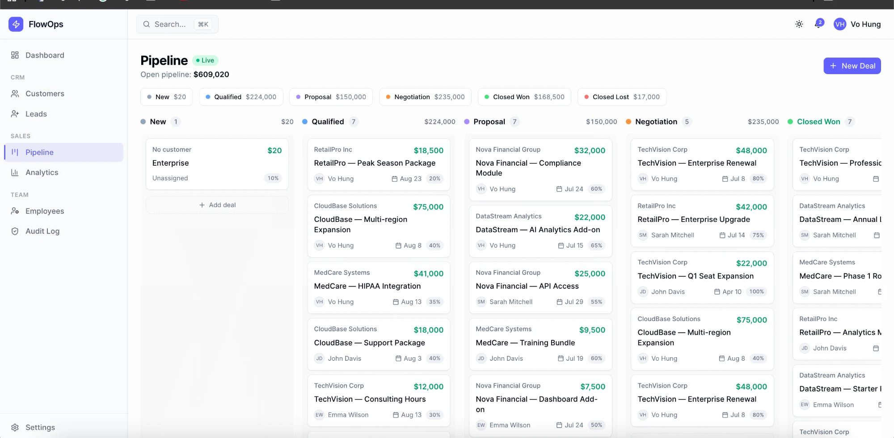
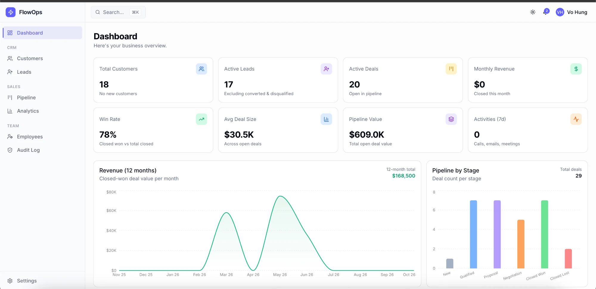
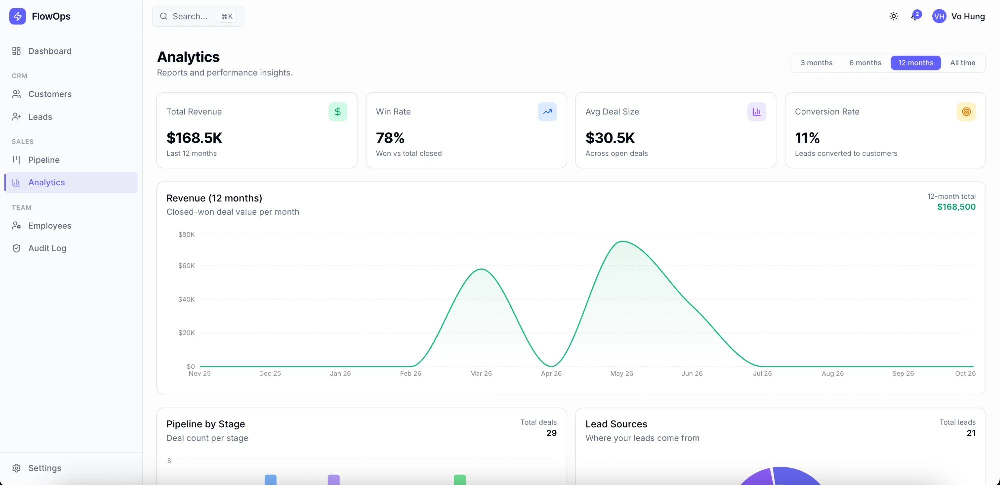

# FlowOps


CRM SaaS with role-based access control (RBAC), built on Next.js 16 and Supabase. Manage customers, leads, and a Kanban sales pipeline in one place.

**Live demo:** https://flowops-steel.vercel.app/

## Demo account

Sign in at the live demo with:

| Role | Email | Password |
|---|---|---|
| Sales rep | `sarah.rep@demo.app` | `demo@2026` |

This is a shared demo account with sample data only.

## Screenshots

**Sales Pipeline (Kanban)**



| Dashboard | Analytics |
|---|---|
|  |  |

## Features

- **Authentication** - Email/password login, Magic Link, password reset.
- **Dashboard** - Key metrics and recent activity at a glance.
- **Customers** - Full CRUD, tags, search, filters, and pagination.
- **Leads** - Track leads by status and source, and convert them to deals.
- **Sales Pipeline** - Kanban board with drag and drop (dnd-kit). Configurable stages.
- **Employees** - Team management and role assignment.
- **Analytics** - Conversion funnel, lead sources, and rep leaderboard with period selector.
- **Audit Log** - Immutable record of important changes.
- **Notifications** - In-app notification bell.
- **Command Palette** - Global search and quick navigation.
- **Settings** - Profile and app preferences.
- **UI** - Dark/light theme, responsive layout, loading skeletons, SEO metadata.

## Roles (RBAC)

| Role | Access |
|---|---|
| Admin | Full access |
| Manager | Team-scoped data |
| Employee | Own data only |

Access is enforced at the database level with Supabase Row Level Security (RLS), and at the route level in `src/proxy.ts`.

## Architecture

### Data model

```
auth.users 1─1 profiles (role: admin | manager | employee)
customers ─< customer_tags >─ tags
customers ─< deals >─ pipeline_stages
leads ──(convert)──> customers / deals
activities  -> linked to a customer, lead, or deal
audit_logs  -> append-only (no UPDATE / DELETE policy)
```

### Request flow

- Pages are Server Components. They read data through `src/lib/queries/`.
- Mutations are Server Actions in `src/lib/actions/`. Each action validates input with Zod, writes, then calls `revalidatePath`.
- Three Supabase clients are used: browser, server, and proxy. Each is used only in its own context.
- `src/proxy.ts` protects all dashboard routes (Next.js 16 `proxy`, replaces `middleware`).

### Security model

- Authorization lives in the database. Every table has Row Level Security (RLS) enabled.
- Policies use a `SECURITY DEFINER` function, `current_user_role()`, to read the role without RLS recursion.
- Employees see their own records. Managers and admins see wider scopes. Only admins manage roles.
- A hardening migration blocks role self-escalation on `profiles` with a `WITH CHECK` clause.
- Note: this is a single-organization app with role-based scoping, not multi-tenant.

### Lead scoring

`src/lib/lead-scoring.ts` computes a 0-100 score from profile completeness (25), source (25), status (20), and activity engagement (30). It is a pure function covered by unit tests.

## Tech Stack

- **Framework:** Next.js 16 (App Router), React 19, TypeScript
- **Backend:** Supabase (PostgreSQL, Auth, Realtime)
- **UI:** Tailwind CSS 4, shadcn/ui on `@base-ui/react`, lucide-react
- **Forms & validation:** react-hook-form, Zod v4
- **Data & charts:** TanStack Table, Recharts
- **Drag and drop:** dnd-kit
- **Hosting:** Vercel

## Getting Started

### Requirements

- Node.js 20+
- A Supabase project

### Setup

```bash
git clone <repo-url>
cd flowops
npm install
cp .env.example .env.local
```

Fill in `.env.local` (Supabase Dashboard -> Settings -> API):

| Variable | Description |
|---|---|
| `NEXT_PUBLIC_SUPABASE_URL` | Supabase project URL |
| `NEXT_PUBLIC_SUPABASE_ANON_KEY` | Supabase anon key |
| `NEXT_PUBLIC_APP_URL` | App URL, used for the Magic Link redirect |

### Database

1. Open Supabase Dashboard -> SQL Editor.
2. Run the files in `supabase/migrations/` in order.
3. (Optional) Run `supabase/seed.sql` for sample data.
4. Sign up the first user, then run `supabase/promote_first_admin.sql` to make them admin.

### Run

```bash
npm run dev
```

Open http://localhost:3000.

## Scripts

| Command | Description |
|---|---|
| `npm run dev` | Start the dev server |
| `npm run build` | Production build |
| `npm run start` | Run the production build |
| `npm run lint` | Run ESLint |
| `npm test` | Run unit tests (Vitest) |
| `npx tsc --noEmit` | Type-check |

CI runs lint, type-check, and tests on every push and pull request (`.github/workflows/ci.yml`).

## Project Structure

```
src/
  app/
    (auth)/          # login, reset-password
    (dashboard)/     # protected pages
    auth/callback/   # Magic Link handler
  components/        # UI and feature components
  lib/
    actions/         # Server Actions (mutations)
    queries/         # Server-side data fetching
    supabase/        # client / server / middleware clients
    validations/     # Zod schemas
  types/             # Database and app types
  proxy.ts           # Route protection
supabase/
  migrations/        # SQL schema, RLS, notifications
```

## License

MIT. See [LICENSE](LICENSE).

## Deployment

Deployed on Vercel. Set the three environment variables above in the Vercel project settings, and set `NEXT_PUBLIC_APP_URL` to the production URL.
